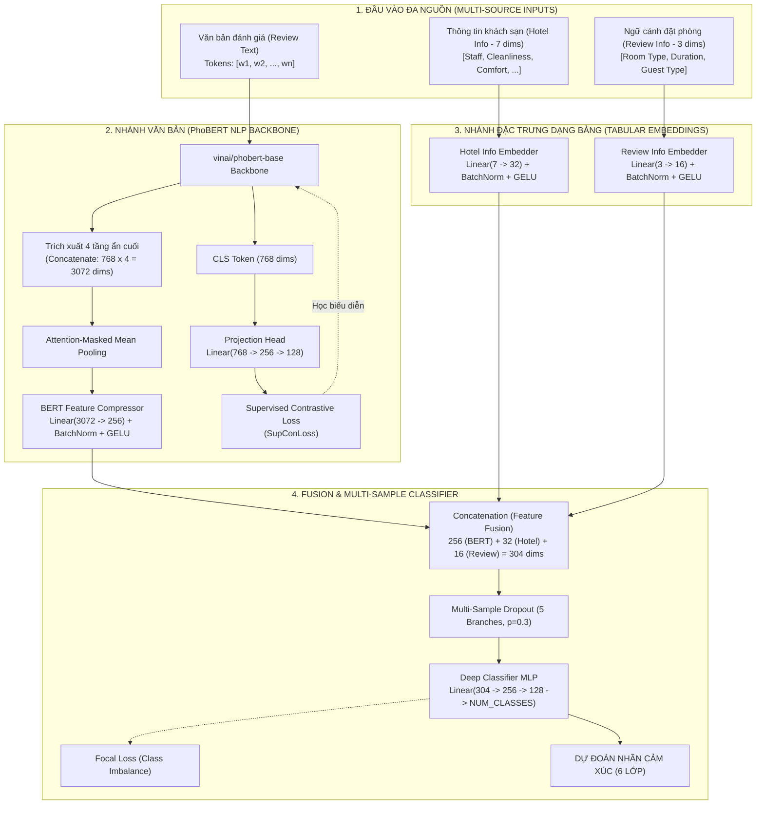
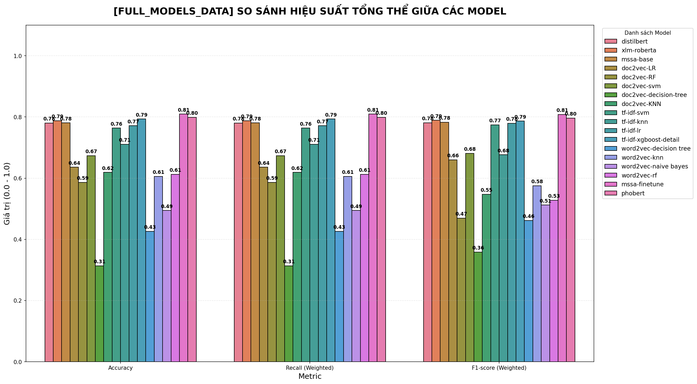
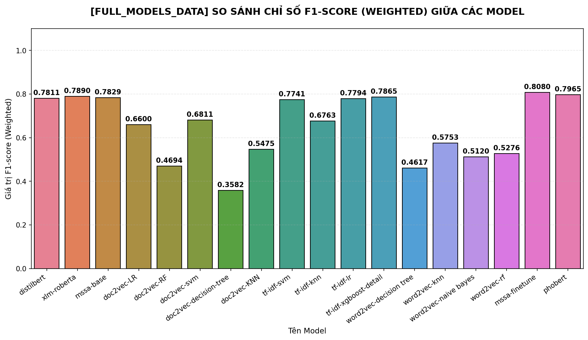
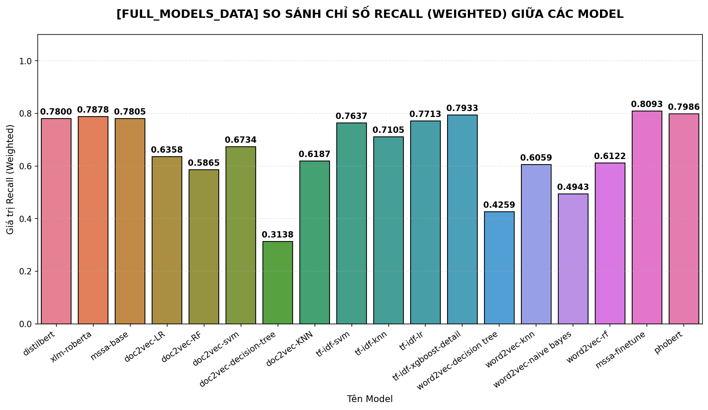

# 🏨 Multi-Source Sentiment Analysis (MSSA) for Vietnamese Hotel Reviews

[](https://www.python.org/)
[](https://pytorch.org/)
[](https://huggingface.co/)
[](https://huggingface.co/vinai/phobert-base)
[](LICENSE)

Dự án nghiên cứu và phát triển mô hình **Phân loại cảm xúc đánh giá khách sạn tiếng Việt đa nguồn (Multi-Source Sentiment Analysis - MSSA)** trên tập dữ liệu thu thập từ **Booking.com**. 

Mô hình đề xuất tích hợp đồng thời **nội dung văn bản đánh giá** (Textual Reviews), **điểm số dịch vụ khách sạn** (Hotel Metadata), và **thông tin ngữ cảnh đặt phòng** (Review/Booking Context) kết hợp cơ chế học biểu diễn đối nghịch có giám sát (**Supervised Contrastive Learning - SupCon**) và hàm mất mát tiêu điểm (**Focal Loss**).

---

## 📌 Mục lục
- [Giới thiệu tổng quan](#-giới-thiệu-tổng-quan)
- [Kiến trúc mô hình đề xuất (MSSA)](#-kiến-trúc-mô-hình-đề-xuất-mssa)
- [Bộ dữ liệu Booking.com](#-bộ-dữ-liệu-bookingcom)
- [Kết quả thực nghiệm & So sánh](#-kết-quả-thực-nghiệm--so-sánh)
  - [Biểu đồ tổng quan](#1-biểu-đồ-tổng-quan-các-mô-hình)
  - [Chỉ số Accuracy](#2-so-sánh-chỉ-số-accuracy)
  - [Chỉ số F1-Score (Weighted)](#3-so-sánh-chỉ-số-f1-score-weighted)
  - [Chỉ số Recall (Weighted)](#4-so-sánh-chỉ-số-recall-weighted)
  - [Bảng tổng hợp chi tiết](#5-bảng-tổng-hợp-kết-quả-đầy-đủ)
- [Nghiên cứu thành phần & Tinh chỉnh siêu tham số](#-nghiên-cứu-thành-phần--tinh-chỉnh-siêu-tham-số)
- [Cấu trúc mã nguồn](#-cấu-trúc-mã-nguồn)
- [Cài đặt & Hướng dẫn sử dụng](#-cài-đặt--hướng-dẫn-sử-dụng)
- [Hướng dẫn tải lên GitHub](#-hướng-dẫn-tải-lên-github)

---

## 📖 Giới thiệu tổng quan

Trong các bài toán phân tích cảm xúc (Sentiment Analysis) thông thường, mô hình chỉ dựa vào nội dung văn bản (Textual Review). Tuy nhiên, trong thực tế đặt phòng khách sạn:
- Ý kiến văn bản có thể mang tính chủ quan hoặc hàm ý mơ hồ ("khách sạn bình thường", "tàm tạm").
- Cảm xúc của khách hàng chịu ảnh hưởng sâu sắc từ **chất lượng dịch vụ khách quan** (nhân viên, độ sạch sẽ, vị trí, tiện nghi, v.v.) và **bối cảnh cá nhân** (đi công tác, du lịch một mình, du lịch gia đình, loại phòng lưu trú).
- Phân bố nhãn đánh giá thường bị **lệch lớp nghiêm trọng** (Class Imbalance) - đa số đánh giá rơi vào điểm số rất cao hoặc rất thấp.

**Đóng góp cốt lõi của đề tài:**
1. **Kiến trúc đa nguồn (MSSA)**: Kết hợp biểu diễn văn bản ngữ nghĩa sâu từ pre-trained Transformer tiếng Việt (**PhoBERT**) cùng mạng nhúng đặc trưng số cho thông tin khách sạn và ngữ cảnh đặt phòng.
2. **Nén đặc trưng 4 tầng ẩn BERT**: Trích xuất và kết hợp 4 tầng ẩn cuối (`last 4 hidden states`), áp dụng Mean Pooling và nén thông minh qua tầng nén tuyến tính (Linear Compression + BatchNorm + GELU + Dropout) nhằm cân bằng tỷ trọng với các đặc trưng dạng bảng.
3. **Cơ chế Loss hỗn hợp (Hybrid Loss)**: Tích hợp **Supervised Contrastive Loss (SupConLoss)** qua Projection Head độc lập để gom cụm các mẫu cùng lớp và đẩy xa các mẫu khác lớp trong không gian tiềm ẩn, kết hợp **Focal Loss** để phạt nặng các mẫu khó và giải quyết mất cân bằng dữ liệu.
4. **Multi-Sample Dropout**: Áp dụng 5 nhánh dropout song song nhằm ổn định gradient và ngăn ngừa overfitting hiệu quả.

---

## 🏗 Kiến trúc mô hình đề xuất (MSSA)

Mô hình nhận 3 đầu vào đa nguồn và đưa ra dự đoán qua luồng xử lý khép kín:



---

## 📊 Bộ dữ liệu Booking.com

Dữ liệu được thu thập từ nền tảng đặt phòng trực tuyến **Booking.com** tại 4 trung tâm du lịch lớn của Việt Nam:
- **TP. Hồ Chí Minh**
- **Khánh Hòa** (Nha Trang, Cam Ranh)
- **Lâm Đồng** (Đà Lạt)
- **Bình Định** (Quy Nhơn)

### Các trường dữ liệu chính:
1. **Nội dung đánh giá (Textual Review)**:
   - Được tiền xử lý chuẩn hóa ký tự, loại bỏ nhiễu, và phân đoạn từ tiếng Việt (Word Segmentation).
   - Ví dụ: *"phòng sạch_sẽ nhân_viên thân_thiện đồ_ăn sáng phong_phú vị_trí thuận_tiện..."*
2. **Đặc trưng khách sạn (Hotel Info - 7 chiều vector)**:
   - Điểm số đánh giá trung bình theo các tiêu chí chuẩn quốc tế: *Nhân viên (Staff)*, *Tiện nghi (Facilities)*, *Độ sạch sẽ (Cleanliness)*, *Thoải mái (Comfort)*, *Đáng giá tiền (Value for money)*, *Vị trí (Location)*, *WiFi miễn phí (Free WiFi)*.
3. **Đặc trưng đặt phòng (Review/Booking Info - 3 chiều vector)**:
   - Loại phòng khách đã chọn (*Room Type*).
   - Thời gian lưu trú (*Stay Duration*).
   - Nhóm khách hàng (*Group Type*: Cặp đôi, Gia đình, Khách lẻ, Khách công tác).
4. **Nhãn cảm xúc**:
   - Được mã hóa và gom nhóm về thang đo 6 lớp đánh giá phục vụ huấn luyện và đánh giá.

---

## 📈 Kết quả thực nghiệm & So sánh

Dự án thực hiện so sánh toàn diện giữa **18 mô hình** gồm:
- **Pre-trained Transformers (Deep Learning)**: MSSA (Fine-tune), PhoBERT Base, XLM-RoBERTa, MSSA (Base), DistilBERT.
- **Machine Learning + TF-IDF**: XGBoost, Logistic Regression, SVM, K-Nearest Neighbors.
- **Machine Learning + Word2Vec**: Random Forest, KNN, Naive Bayes, Decision Tree.
- **Machine Learning + Doc2Vec**: SVM, Logistic Regression, KNN, Random Forest, Decision Tree.

---

### 1. Biểu đồ tổng quan các mô hình



*Hình 1: So sánh tổng thể các chỉ số Accuracy, Recall (Weighted) và F1-score (Weighted) giữa tất cả các mô hình.*

---

### 2. So sánh chỉ số Accuracy


*Hình 2: Xếp hạng độ chính xác (Accuracy) chi tiết từng mô hình trên tập kiểm tra.*

---

### 3. So sánh chỉ số F1-Score (Weighted)



*Hình 3: So sánh chỉ số F1-Score (Weighted) - chỉ số đo lường tin cậy trên dữ liệu mất cân bằng lớp.*

---

### 4. So sánh chỉ số Recall (Weighted)



*Hình 4: So sánh chỉ số Recall (Weighted) của các mô hình.*

---

### 5. Bảng tổng hợp kết quả đầy đủ

| Hạng | Tên Model | Kiến trúc / Phương pháp | Accuracy | F1-Score (Weighted) | Recall (Weighted) |
| :---: | :--- | :--- | :---: | :---: | :---: |
| 🥇 | **MSSA (Fine-tune)** *(Đề xuất)* | **PhoBERT + Tabular + SupCon + Focal Loss** | **0.8093** | **0.8080** | **0.8093** |
| 🥈 | **PhoBERT** | PhoBERT Base (Chỉ văn bản) | 0.7986 | 0.7965 | 0.7986 |
| 🥉 | **TF-IDF + XGBoost** | TF-IDF Vectorizer + XGBoost Detail | 0.7933 | 0.7865 | 0.7933 |
| 4 | **XLM-RoBERTa** | Multilingual XLM-RoBERTa Base | 0.7878 | 0.7890 | 0.7878 |
| 5 | **MSSA (Base)** | PhoBERT + Multi-Source Baseline | 0.7805 | 0.7829 | 0.7805 |
| 6 | **DistilBERT** | DistilBERT Multilingual Base | 0.7800 | 0.7811 | 0.7800 |
| 7 | **TF-IDF + LR** | TF-IDF + Logistic Regression | 0.7713 | 0.7794 | 0.7713 |
| 8 | **TF-IDF + SVM** | TF-IDF + Support Vector Machine | 0.7637 | 0.7741 | 0.7637 |
| 9 | **TF-IDF + KNN** | TF-IDF + K-Nearest Neighbors | 0.7105 | 0.6763 | 0.7105 |
| 10 | **Doc2Vec + SVM** | Doc2Vec Embeddings + SVM | 0.6734 | 0.6811 | 0.6734 |
| 11 | **Doc2Vec + LR** | Doc2Vec Embeddings + Logistic Regression | 0.6358 | 0.6600 | 0.6358 |
| 12 | **Doc2Vec + KNN** | Doc2Vec Embeddings + KNN | 0.6187 | 0.5475 | 0.6187 |
| 13 | **Word2Vec + RF** | Word2Vec Averaged + Random Forest | 0.6122 | 0.5276 | 0.6122 |
| 14 | **Word2Vec + KNN** | Word2Vec Averaged + KNN | 0.6059 | 0.5753 | 0.6059 |
| 15 | **Doc2Vec + RF** | Doc2Vec Embeddings + Random Forest | 0.5865 | 0.4694 | 0.5865 |
| 16 | **Word2Vec + NB** | Word2Vec Averaged + Gaussian Naive Bayes | 0.4943 | 0.5120 | 0.4943 |
| 17 | **Word2Vec + DT** | Word2Vec Averaged + Decision Tree | 0.4259 | 0.4617 | 0.4259 |
| 18 | **Doc2Vec + DT** | Doc2Vec Embeddings + Decision Tree | 0.3138 | 0.3582 | 0.3138 |

> **Nhận xét chính:**
> - Mô hình **MSSA (Fine-tune)** vượt trội hơn toàn bộ các mô hình khác, đạt **80.93% Accuracy** và **0.8080 F1-Score**.
> - Việc tích hợp thêm siêu dữ liệu khách sạn và đặt phòng giúp cải thiện đáng kể so với PhoBERT chỉ sử dụng văn bản đơn thuần (+1.07% Accuracy, +1.15% F1-score).
> - Trong nhóm mô hình ML truyền thống, **TF-IDF kết hợp XGBoost** đạt hiệu suất rất ấn tượng (79.33%), cạnh tranh trực tiếp với các mô hình Transformer đa ngôn ngữ.

---

## 🔬 Nghiên cứu thành phần & Tinh chỉnh siêu tham số

Dự án thực hiện các phân tích chuyên sâu nhằm tìm kiếm cấu hình tối ưu:

### 1. Phân tích Ablation Study (Loại bỏ thông tin khách sạn)
- Thư mục `DL/No infor hotel/` chứa các thí nghiệm khi **loại bỏ vector thông tin khách sạn** trên PhoBERT, XLM-RoBERTa, DistilBERT. Kết quả xác nhận việc bổ sung ngữ cảnh khách quan đóng vai trò quan trọng nâng cao độ chính xác.

### 2. Kích thước nén đặc trưng BERT (128 vs 256 dimensions)
- Thư mục `Statistics/128/` và `Statistics/256/` kiểm nghiệm kích thước nén của `BERT Compressor`. Kết quả cho thấy kích thước **256 chiều** giữ được lượng thông tin tối ưu nhất khi kết hợp với các vector thông tin phụ (32 + 16 chiều).

### 3. Tinh chỉnh số Epoch (2, 3, 4, 6, 7, 10 Epochs)
- Thư mục `Statistics/Epochs/` khảo sát sự hội tụ của mô hình qua các số lượng epoch khác nhau. Số epoch tối ưu nằm trong khoảng từ **3 đến 4 epoch** kết hợp warm-up scheduler để tránh hiện tượng overfitting.

### 4. Tinh chỉnh tỷ lệ hàm mất mát (SupConLoss vs FocalLoss)
- Thư mục `Statistics/test/` kiểm nghiệm các tỷ lệ trọng số giữa SupConLoss và Focal Loss: `1:7`, `2:6`, `3:5`, `4:4`, `5:3`, `6:2`, `1.5:6.5`.

### 5. Kiểm định ý nghĩa thống kê (Statistical Significance Tests)
- Thư mục `DL/statistical significance tests/` thực hiện các vòng thử nghiệm lặp lại (multiple runs) giữa nhóm Deep Learning và Machine Learning để bảo đảm tính khách quan và ý nghĩa thống kê của kết quả.

---

## 📁 Cấu trúc mã nguồn

```plaintext
Bert/
├── Data/                                       # Dữ liệu thực nghiệm
│   ├── booking_sent_analysis_data_clean_test.pkl  # Dữ liệu kiểm tra mẫu nhỏ
│   ├── booking_sent_analysis_data.pkl             # Tập dữ liệu huấn luyện chính
│   └── clean_hochinhminh_khanhhoa_lamdong_binhdinh.csv # Dữ liệu thô đã làm sạch
│
├── DL/                                         # Các mô hình Deep Learning
│   ├── fine_tune_mssa-bookingreview-word-segmented_best_now.ipynb  # MSSA Fine-tune tốt nhất
│   ├── phobert-bookingreview-infor-word-segmented.ipynb            # PhoBERT chuẩn
│   ├── xlmr-infor-bookingreview-mssa.ipynb                         # XLM-RoBERTa
│   ├── distil-infor-bookingreview-mssa.ipynb                       # DistilBERT
│   ├── No infor hotel/                         # Nghiên cứu Ablation (không dùng hotel info)
│   └── statistical significance tests/         # Kiểm định ý nghĩa thống kê
│
├── ML/                                         # Các mô hình Machine Learning truyền thống
│   ├── tf-idf-xgboost-detail.ipynb             # TF-IDF + XGBoost
│   ├── tf-idf-svm-bookingreview.ipynb          # TF-IDF + SVM
│   ├── tf-idf-lr-bookingreview.ipynb           # TF-IDF + Logistic Regression
│   ├── tf-idf-knn-bookingreview.ipynb          # TF-IDF + KNN
│   ├── word2vec-*.ipynb                        # Word2Vec + SVM, RF, KNN, NB, DT
│   └── doc2vec-*.ipynb                         # Doc2Vec + SVM, LR, RF, KNN, DT
│
├── plots/                                      # Biểu đồ kết quả trực quan hóa
│   ├── FULL_MODELS_DATA_OVERALL_SUMMARY.png    # Biểu đồ so sánh tổng thể
│   ├── FULL_MODELS_DATA_SINGLE_ACCURACY.png    # Biểu đồ so sánh Accuracy
│   ├── FULL_MODELS_DATA_SINGLE_F1-SCORE.png    # Biểu đồ so sánh F1-Score
│   └── FULL_MODELS_DATA_SINGLE_RECALL.png      # Biểu đồ so sánh Recall
│
├── Statistics/                                 # Các thử nghiệm tinh chỉnh siêu tham số
│   ├── 128/                                    # Thử nghiệm kích thước nén 128
│   ├── 256/                                    # Thử nghiệm kích thước nén 256
│   ├── Epochs/                                 # Thử nghiệm số epoch (2, 3, 4, 6, 7, 10)
│   └── test/                                   # Thử nghiệm tỷ lệ SupCon vs Focal Loss
│
├── .gitignore                                  # Cấu hình bỏ qua file nặng & giữ lại plots
├── requirements.txt                            # Danh sách thư viện phụ thuộc
└── README.md                                   # Tài liệu dự án
```

---

## 🚀 Cài đặt & Hướng dẫn sử dụng

### 1. Khởi tạo môi trường ảo

Khuyến nghị sử dụng Python 3.8 hoặc 3.10:

```bash
# Tạo virtual environment
python -m venv venv

# Kích hoạt trên Windows:
.\venv\Scripts\activate

# Hoặc trên Linux/macOS:
source venv/bin/activate
```

### 2. Cài đặt các thư viện cần thiết

```bash
pip install --upgrade pip
pip install -r requirements.txt
```

> [!NOTE]
> Nếu bạn sử dụng GPU NVIDIA (CUDA), vui lòng cài đặt phiên bản PyTorch tương ứng từ [trang chủ PyTorch](https://pytorch.org/get-started/locally/) trước khi cài đặt các thư viện khác:
> ```bash
> pip install torch torchvision torchaudio --index-url https://download.pytorch.org/whl/cu118
> ```

### 3. Chạy thực nghiệm

Mở Jupyter Lab hoặc Jupyter Notebook để chạy các notebook:

```bash
jupyter notebook
```

- **Huấn luyện mô hình MSSA tốt nhất**: Mở và chạy `DL/fine_tune_mssa-bookingreview-word-segmented_best_now.ipynb`.
- **Chạy các baseline Machine Learning**: Truy cập thư mục `ML/` và chọn notebook tương ứng (TF-IDF, Word2Vec, Doc2Vec).

---

## 📤 Hướng dẫn tải lên GitHub

File `.gitignore` đã được cấu hình tối ưu sẵn:
- **Tự động giữ lại và theo dõi** toàn bộ thư mục `plots/` và tất cả hình ảnh `.png` để README hiển thị đẹp mắt trên GitHub.
- **Tự động loại trừ** các file checkpoints (`.pt`, `.bin`), thư mục cache (`__pycache__`, `.ipynb_checkpoints`), và các file dữ liệu nặng quá giới hạn khuyến nghị của GitHub.

Các bước đưa dự án lên GitHub:

```bash
# 1. Khởi tạo kho chứa Git cục bộ (nếu chưa có)
git init

# 2. Thêm tất cả các file đã lọc bởi .gitignore
git add .

# 3. Kiểm tra trạng thái đảm bảo các ảnh trong plots/ đã được add
git status

# 4. Tạo commit đầu tiên
git commit -m "feat: Initial commit with MSSA model, experiments, plots and comprehensive README"

# 5. Đổi nhánh mặc định thành main
git branch -M main

# 6. Liên kết với kho chứa trên GitHub của bạn
git remote add origin https://github.com/<tai-khoan-cua-ban>/<ten-repository>.git

# 7. Đẩy mã nguồn lên GitHub
git push -u origin main
```

---

## 📜 Giấy phép & Trích dẫn

Dự án được phân phối dưới giấy phép **MIT License**. 

